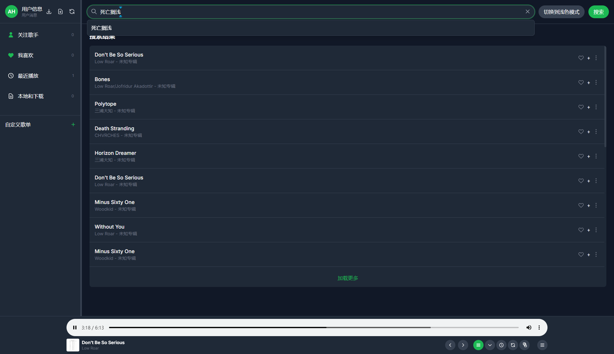
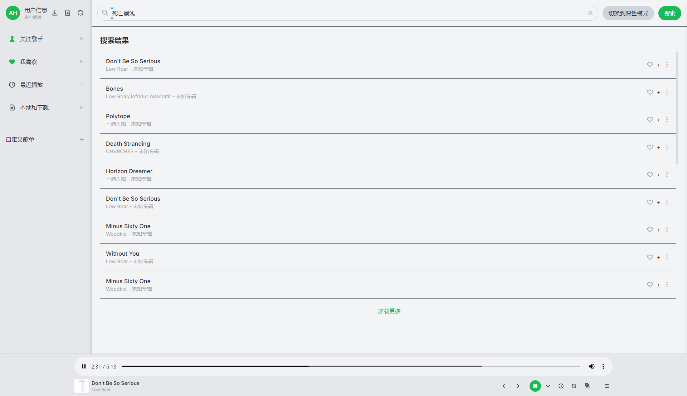
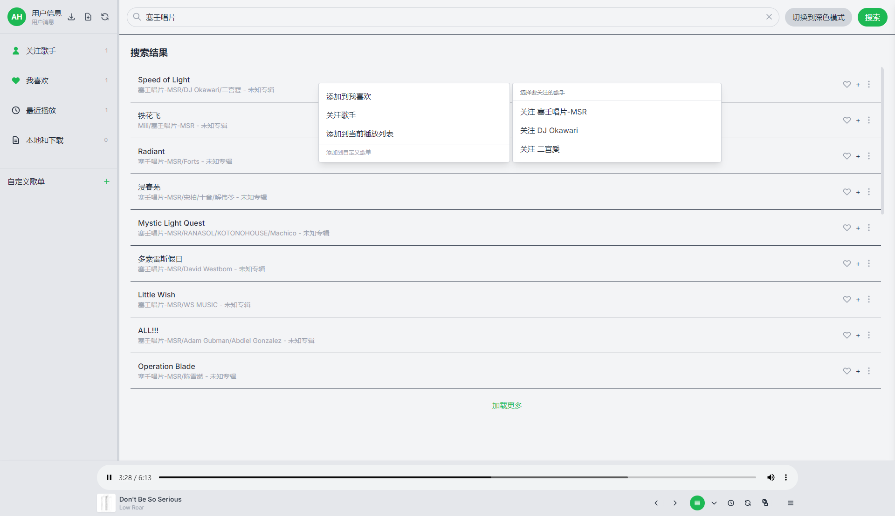
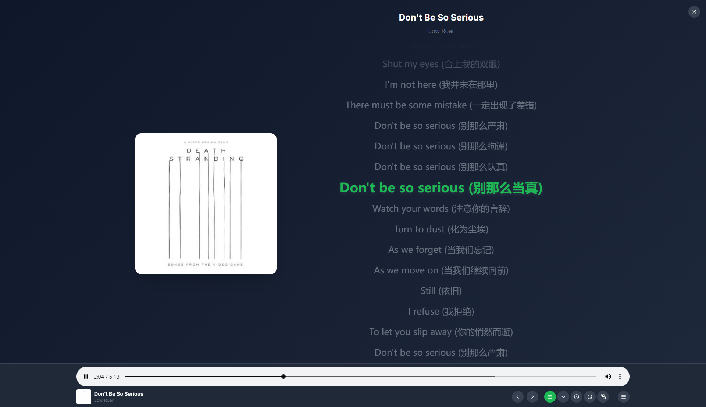
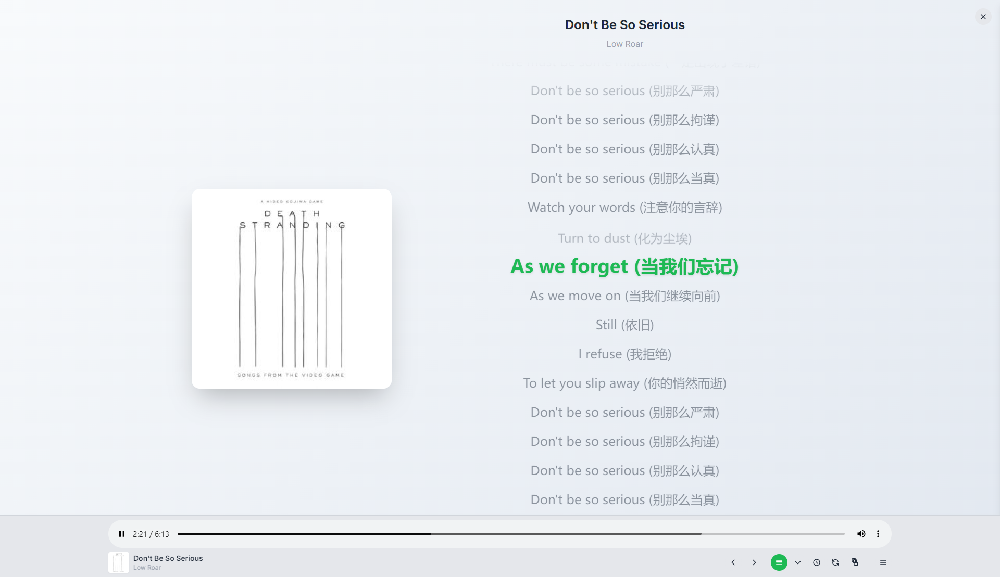
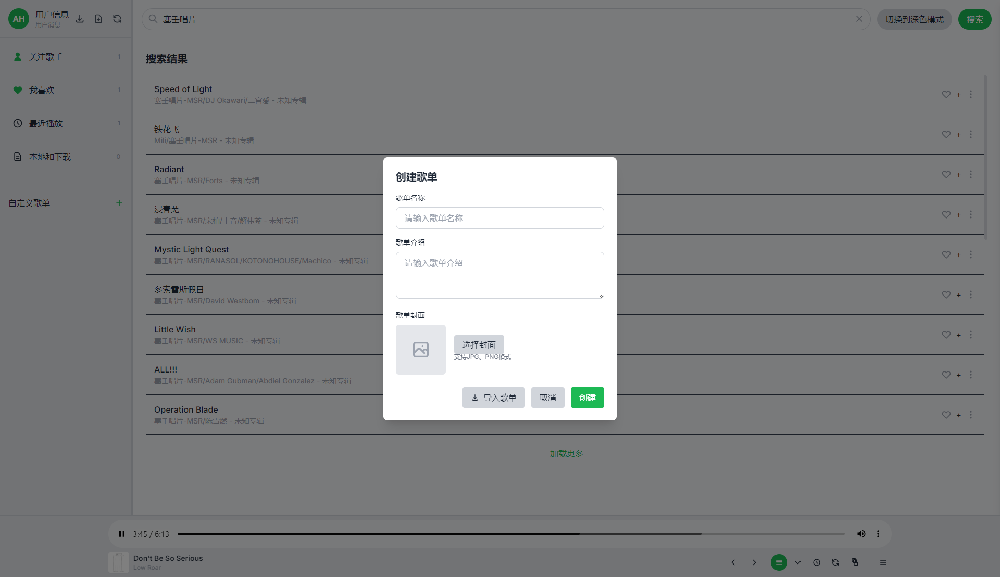
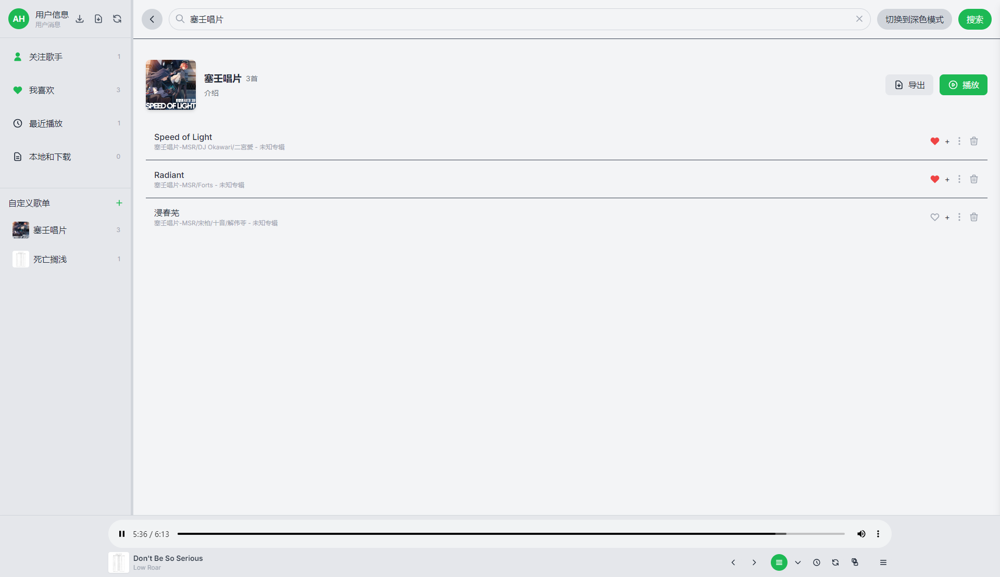
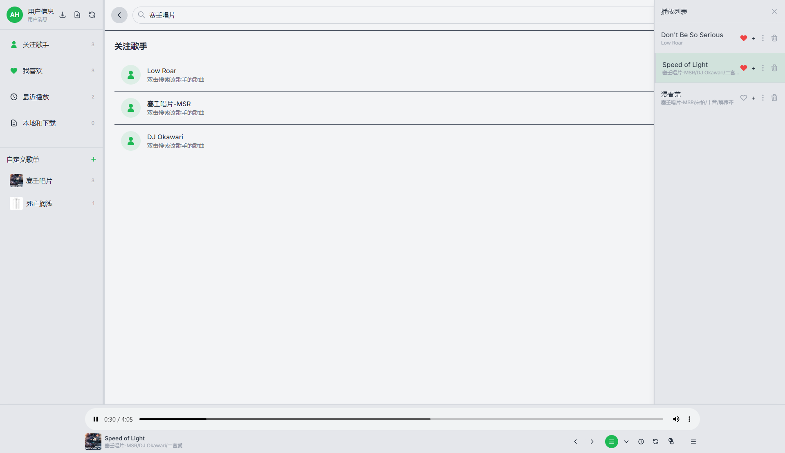

# MusicPlayer

个人项目，AI生成，仅供学习娱乐，不可商用

## 下载

[点击此处跳转下载](https://github.com/AH23333/MusicPlayer/releases)

## 📋 项目功能

### 核心功能

- 🔍 **音乐搜索**：支持在线搜索音乐
- 🎶 **关注歌手**：一键关注喜爱的歌手
- ❤️ **我喜欢的歌曲**：收藏喜爱的音乐
- 📚 **最近播放**：记录最近播放的歌曲
- 💾 **本地和下载**：支持导入导出本地音频文件
  - 支持多种音频格式：mp3、wav、flac、m4a
  - 自动提取歌曲信息
  - 支持删除本地歌曲
- 🎵 **自建歌单**：创建和管理个人歌单、导入网易云/QQ音乐歌单
- 🎛️ **多种播放模式**：顺序、倒序、单曲循环、列表循环、随机
- 📝 **歌词显示**：实时歌词同步显示
- 🌙 **深色/浅色模式**：根据系统或手动切换
- 🔧 **数据导入导出**：支持个人数据的备份与恢复

### 增强功能

> 以下增强功能由重构后新增的 `src/renderer/js/features.js` 提供。

- 🎚️ **均衡器（EQ）**：10 段参量均衡器，内置流行 / 摇滚 / 人声增强 / 重低音等预设，可自定义
- 🌊 **淡入淡出**：歌曲开头淡入、结尾淡出，过渡时长可调（1–6 秒）
- ⏩ **播放速度**：0.5×–2× 变速播放
- 🔊 **音量增益 / 声道平衡**：响度增强（0.5–3×）与左右声道平衡调节
- 📊 **频谱可视化**：歌词页底部实时音频频谱
- 🪟 **桌面歌词**：独立桌面歌词窗口，字号与歌词页同步
- 🔤 **歌词字号 / 时间轴校正**：歌词小 / 中 / 大三档，支持 ±0.2 秒偏移校正
- 🖥️ **迷你模式**：紧凑迷你播放条，一键还原主界面
- 💾 **记忆播放**：记住音量、播放模式与上次播放进度，启动时自动恢复
- ⏱️ **睡眠定时**：15/30/45/60 分钟、自定义分钟或「播完当前歌曲」后自动停止播放
- 🔁 **A-B 片段循环**：设置 A/B 两点循环播放，适合练外语 / 乐器
- 🔀 **队列拖拽**：播放列表拖拽排序，支持一键去重与清空
- 📈 **听歌统计**：总播放次数、累计时长、最常听 Top 10、常听歌手
- 🎛️ **智能歌单**：基于听歌统计自动生成「最常播放」「最近添加」歌单
- 🏠 **发现首页**：问候语 + 快捷入口 + 最近播放 / 我喜欢的卡片推荐
- ⌨️ **媒体键 / MediaSession**：支持系统媒体键与系统媒体中心控制播放
- 🔔 **系统通知**：切歌时弹出系统通知（可在设置中关闭）
- 📂 **拖放导入**：将本地音频文件拖入窗口即可加入播放队列
- 🎨 **外观强调色**：内置多款强调色，自定义界面主题色
- 📐 **侧边栏折叠**：可折叠侧边栏，扩大主内容区
- 🔑 **快捷键**：空格播放、方向键快进快退（Shift 为 15 秒）、音量键调节、Ctrl/⌘+F 聚焦搜索、Esc 关闭弹窗等

### v1.3.0 新增功能

- 📊 **年度听歌报告**：生涯 / 年度双模式，7 页故事流（总览、时长、次数、歌手、歌曲、时刻、结语），支持键盘导航与一键复制分享文案
- 🖼️ **封面 / 下载 / 登录增强**：歌单封面裂图自动代理回退；批量下载前逐源预检并二次确认；支持 Cookie 手动导入登录音乐源
- 📚 **音乐库浏览页**：本地音乐按歌手 / 格式分组浏览、重复文件检测与"保留最新"一键清理、文件定位与删除管理
- 🌐 **翻译歌词**：接入网易官方翻译歌词接口，原文 + 译文双行对齐显示，桌面歌词窗口同步译文
- 🖥️ **系统集成**：单实例锁（重复启动自动聚焦已有窗口）、文件关联打开（双击音频文件直接入队播放）、播放时阻止系统休眠
- 🎵 **无间隙播放**：自动预载下一首歌曲，切歌即播几乎无缝；歌词加载不再阻塞播放启动

## ✨ 项目特色

- **无需登录**：无登录权限，无需注册即可使用
- **本地存储**：无需配置数据库，所有数据均存储在本地文件中
- **离线播放**：支持离线状态下播放本地歌曲
- **跨平台**：支持 Windows、macOS、Linux

## 📷 项目截图（非最新项目截图）










## 🛠️ 技术栈

- **Electron**：跨平台桌面应用框架
- **Tailwind CSS**：实用优先的CSS框架
- **JavaScript**：应用逻辑实现
- **axios**：网络请求库（用于搜索音乐、获取歌词）
- **Go**：用于 go-music-dl API 服务

## 🚀 快速开始

### 1. 环境准备

确保你的系统已安装 Node.js（建议使用 LTS 版本）。

### 2. 安装依赖

```bash
# 克隆仓库
git clone git@github.com:AH23333/MusicPlayer.git
cd MusicPlayer

# 安装依赖
npm install
```

### 3. go-music-dl API 服务

项目集成了 go-music-dl API 服务，用于音乐搜索和获取。已包含预编译的可执行文件 `music-dl-api.exe`（Windows 平台）。

- **Windows**：直接使用项目根目录中的 `music-dl-api.exe`
- **其他平台**：需要从 [go-music-dl](https://github.com/guohuiyuan/go-music-dl) 项目编译对应平台的可执行文件

### 4. 运行和构建

```bash
# 启动开发模式
npm start

# 打包应用（生成未签名的应用包）
npm run package

# 构建可执行文件（生成安装包）
npm run make
```

## 📁 项目结构

```
MusicPlayer/
├── src/                            # 源代码目录
│   ├── main/                       # Electron 主进程
│   │   ├── main.js                 # 窗口创建、生命周期管理
│   │   ├── ipcHandlers.js          # IPC 通信处理器
│   │   ├── preload.js              # 预加载脚本，安全暴露 API
│   │   └── services/               # 主进程服务
│   │       ├── storage.js          # 文件读写服务
│   │       ├── update.js           # 更新检查与处理
│   │       ├── logger.js           # 日志服务
│   │       └── musicDlService.js   # go-music-dl API 服务管理
│   ├── renderer/                    # 渲染进程（前端）
│   │   ├── index.html              # 主界面 HTML
│   │   ├── desktop-lyrics.html     # 桌面歌词独立窗口
│   │   ├── styles/                  # 样式文件
│   │   │   └── style.css           # 全局样式
│   │   └── js/                     # 前端逻辑（已重构整合）
│   │       ├── app.js              # 渲染进程入口：整合全局状态与播放/搜索/歌单核心逻辑（原 store/modules 整合）
│   │       └── features.js         # 增强功能集：媒体键、托盘通知、记忆播放、迷你模式、睡眠定时、桌面歌词、频谱、淡入淡出、队列拖拽、均衡器、听歌统计、设置面板（原 ui/utils/services 整合）
│   └── config/                     # 配置文件
│       ├── forge.config.js         # Electron Forge 配置
│       ├── tailwind.config.js      # Tailwind 配置
│       └── postcss.config.js       # PostCSS 配置
├── snapshot/                       # 项目截图（用于README）
├── .gitignore                      # Git 忽略文件配置
├── package.json                    # 项目配置和依赖
├── package-lock.json               # 依赖锁定文件
├── music-dl-api.exe                # go-music-dl API 服务可执行文件（Windows）
├── DIYSongList.json                # 自建歌单数据
├── FollowedArtists.json            # 关注歌手数据
├── Latest.json                     # 最新播放数据
├── MyFavorite.json                 # 我喜欢数据
├── PlayList.json                   # 播放列表数据
├── SearchHistory.json              # 搜索历史数据
├── .gitattributes                  # Git 换行符配置
├── scripts/                        # 构建和部署脚本
│   └── sync-to-packaged.ps1       # 同步文件到打包应用
├── .cursor/                        # Cursor IDE 配置
│   └── rules/                      # 自定义规则
│       └── sync-packaged-app.mdc  # 同步规则配置
└── README.md                       # 项目说明文档
```

## 📂 构建输出

项目构建后会生成以下目录和文件（通常不包含在版本控制中）：

- `out/` - 打包后的应用文件
- `node_modules/` - 项目依赖（通过 `npm install` 安装）


## 💾 本地数据管理

- **本地歌曲**：存储在 `ImportLocalSongs` 文件夹
- **歌单封面**：存储在 `DIYSongListPage` 文件夹
- **搜索历史**：存储在 `SearchHistory.json` 文件
- **自建歌单**：存储在 `DIYSongList.json` 文件
- **我喜欢的歌曲**：存储在 `MyFavorite.json` 文件
- **最近播放**：存储在 `Latest.json` 文件
- **播放列表**：存储在 `PlayList.json` 文件
- **关注歌手**：存储在 `FollowedArtists.json` 文件

## ⚠️ 注意事项

- 本项目仅供学习和娱乐使用，不可商用
- 歌曲搜索功能依赖于网络 API，可能会受到网络环境影响
- 本地歌曲导入功能仅支持音频文件，不支持其他格式

## 🤝 贡献指南

1. **创建 Issue**：描述您的功能建议或问题
2. **Fork 仓库**：创建您的个人分支
3. **开发**：实现功能或修复问题
4. **提交 PR**：详细说明您的更改内容

## 🔄 开发指南

### 二次开发注意事项

- 项目已进行重构，代码结构更加清晰
- 如需在网页端部署，可能需要进行额外的适配，本重构版本不再提供网页兼容
- 开发前请确保安装了所有依赖

## 📚 参考项目

- [aura-music](https://github.com/dingyi222666/aura-music.git)
- [Meting](https://github.com/metowolf/Meting.git)
- [go-music-dl](https://github.com/guohuiyuan/go-music-dl.git)

## 📄 第三方组件与许可

本项目代码以 [MIT License](LICENSE) 开源。发行版中捆绑了以下 AGPL-3.0 组件：

- **music-dl-api.exe**：由 [guohuiyuan/go-music-dl](https://github.com/guohuiyuan/go-music-dl)（[AGPL-3.0](https://www.gnu.org/licenses/agpl-3.0.html)）修改构建，为播放器提供本地（127.0.0.1:1989）在线音乐搜索 / 下载 API
  - 修改版完整源码随本仓库发布：[third_party/go-music-dl](third_party/go-music-dl)
  - 许可证文本：[third_party/go-music-dl/LICENSE](third_party/go-music-dl/LICENSE)

# 📝 更新日志

## 2026.3.14

- 修复了歌曲导入功能
- 优化了歌曲功能按钮的位置
- 优化了鼠标单击歌曲高亮卡顿的问题
- 优化了播放列表高亮当前正在播放歌曲的问题
- 增加了更多右键功能
- 增加了关注歌手功能
- 增加了歌单导入导出功能
- 增加了用户信息导入导出功能
- 增加了歌词界面在页面过窄时自动调整的功能

## 2026.3.18

- 经过多方测试，当前搜索功能使用的API已失效，正在寻找平替
- 如果找不到就只能漫长的等待了

## 2026.3.19

- 发现是优先使用的API已失效，启用备用API
- 修复了返回数据解析错误导致无法显示歌曲的问题
- 修复了自动打开控制台的问题

## 2026.3.20

- 增加了版本更新功能

## 2026.3.21

- 修复了一些交互及显示问题

## 2026.3.23

- 通过go-music-dl项目增加了自定义源功能、清除搜索缓存功能，优化搜索历史管理

## 2026.3.30

- 感谢[qjl357](https://github.com/qjl357)增加的网易云/QQ音乐使用链接导入歌单功能、多选下载功能

## 2026.3.31

- 修复导出信息和导出歌单路径错误导致无法导出数据的问题

## 2026.4.2

- 修复导入歌曲路径错误问题

## 2026.4.5

- 修复左侧边栏自定义歌单列表展示的问题

## 2026.10.24

- **新增年度听歌报告**：生涯 / 年度双模式，7 页故事流，键盘导航与一键复制分享
- **封面 / 下载 / 登录增强**：歌单封面裂图自动代理回退；批量下载前逐源预检并二次确认；Cookie 手动导入登录
- **新增音乐库浏览页**：本地音乐按歌手 / 格式分组浏览、重复检测清理、文件定位与删除管理
- **新增翻译歌词**：接入网易官方翻译歌词接口，原文 + 译文双行对齐显示，桌面歌词同步译文
- **新增系统集成**：单实例锁、文件关联打开音频、播放时阻止系统休眠
- **新增无间隙播放**：自动预载下一首即切即播，歌词加载不再阻塞播放启动
- 修复歌单详情页歌曲"喜欢"爱心图标绘制错误
- 修复启动后首次右键歌单菜单定位到侧边栏的问题（Tailwind JIT 异步生成定位类导致）
- 补充第三方组件许可声明：随发行版捆绑的 music-dl-api.exe（AGPL-3.0）修改版源码移入 third_party/go-music-dl 公开

## 2026.10.16

- 重构渲染进程代码结构：将原本分散在 `store/`、`modules/`、`ui/`、`services/`、`utils/` 下的多个文件整合为 `src/renderer/js/app.js`（入口与全局状态/核心播放逻辑）与 `src/renderer/js/features.js`（增强功能集）
- 新增独立桌面歌词窗口 `src/renderer/desktop-lyrics.html`
- 新增 / 整合增强功能（features.js）：均衡器（10 段 + 预设）、淡入淡出、0.5×–2× 变速、音量增益与声道平衡、实时频谱可视化、桌面歌词、歌词字号与 ±0.2s 时间轴校正、迷你模式、记忆播放、睡眠定时、A-B 片段循环、队列拖拽排序 / 去重 / 清空、听歌统计、智能歌单（最常播放 / 最近添加）、发现首页、媒体键 / MediaSession 控制、切歌系统通知、拖放导入本地文件、外观强调色、侧边栏折叠、快捷键
- 同步更新 README「项目结构」与「项目功能（增强功能）」章节，修正过时文档