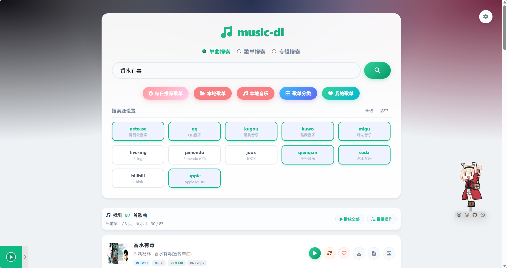
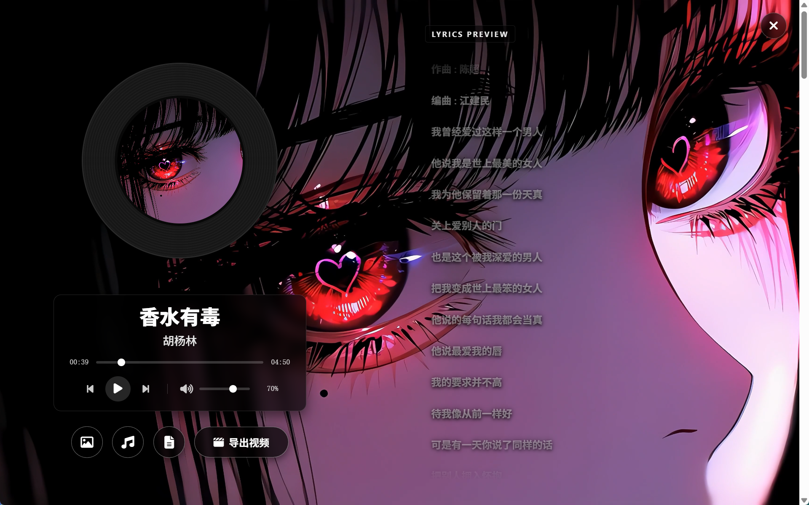
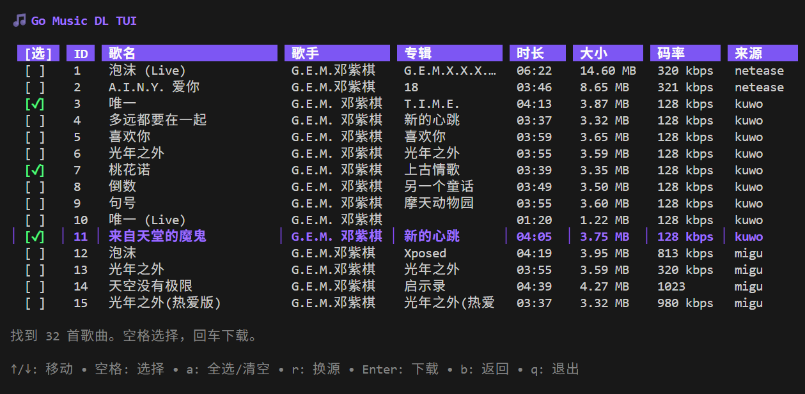
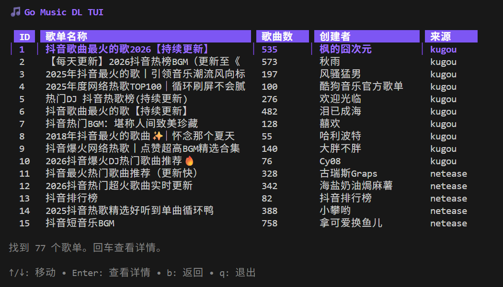

# Go Music DL

> ⭐ 如果这个项目对你有帮助，欢迎点一个 Star。

<p align="center">
  
</p>

Go Music DL 是一个多平台音乐搜索与下载工具，支持 **Web**、**TUI** 和**桌面端**，覆盖单曲、歌单、专辑、排行榜与本地音乐。

## 🚀 快速开始

### 桌面端 / 移动端

从 [Releases](https://github.com/guohuiyuan/go-music-dl/releases) 下载对应安装包：

- Windows / Linux / macOS：从 Releases 下载 `music-dl-desktop-rust` 或 `music-dl-desktop-go` 对应平台包，解压后直接运行。
- Android：优先下载 `music-dl_arm64-v8a.apk`，已内置 FFmpeg，无需额外安装。
- iOS：使用 `music-dl-ios-unsigned.ipa` 自行签名。

### Web / TUI

```bash
# Web，默认访问 http://localhost:8080/music
./music-dl web

# 挂载到反向代理二级目录
./music-dl web --base-path /dl

# 终端搜索
./music-dl -k "周杰伦"
```

Web 的搜索、试听、下载和歌单浏览无需登录；修改设置或 Cookie 时才需要管理员账号。首次配置时，启动日志会打印 `Web setup token`，用它创建管理员账号即可。TUI 常用键：`↑/↓` 移动、`空格` 选择、`a` 全选、`r` 换源、`Enter` 下载、`w` 每日推荐、`q` 退出。

### Docker

```bash
docker compose up -d --pull always --remove-orphans
```

访问 `http://localhost:8080`。首次启动会自动创建 `./data` 并配置好容器写权限；Compose 不依赖仓库里的 Dockerfile 或其他文件，只需 `docker-compose.yml` 和镜像即可启动。修改源码后可使用 `docker compose -f docker-compose.dev.yml up -d --build` 本地构建。

---







## 主要功能

* **多端使用**：Web、TUI 终端和原生桌面应用，桌面端自动启动内置服务。
* **搜索与下载**：多平台聚合搜索单曲、歌单和专辑，支持试听、批量下载、换源和无损音频。
* **歌单管理**：浏览官方分类、个人歌单和排行榜，也可创建本地歌单并跨平台收藏歌曲。
* **登录能力**：支持 Cookie 与扫码登录，用于个人歌单、更高音质和部分受限资源。
* **本地音乐**：扫描、上传、搜索和整理本地音频，自动读取元数据、封面与歌词。
* **播放体验**：支持逐字歌词、歌词字体、全局快捷键、媒体键和播放缓存。

## 歌单 / 专辑支持

Web 与 TUI 都支持单曲、歌单、专辑三种搜索类型；粘贴歌单或专辑链接会自动识别来源并进入详情。曲目列表支持播放、下载、批量操作和导入本地歌单。

渠道覆盖网易云、QQ、酷狗、酷我、咪咕、汽水、Apple Music、Bilibili、Jamendo、JOOX 和千千等，实际可用来源以界面列表为准。

## 歌单分类与我的歌单

* **歌单分类**：支持网易云、QQ、酷狗、酷我、咪咕、千千、JOOX、汽水和 Apple Music；汽水提供每日推荐、流行、华语、欧美、国风等分类。
* **我的歌单**：登录或配置 Cookie 后，可读取网易云、QQ、酷狗和汽水的个人歌单、收藏及喜欢的歌曲。
* **站内处理**：分类歌单和个人歌单均可查看详情、播放、下载、批量操作或导入本地歌单。

## 排行榜

首页“排行榜”聚合网易云、QQ、酷狗、酷我、咪咕、汽水和 Apple Music 的官方榜单。各平台的“热门单曲”对应当地热歌榜，榜单歌曲可直接播放、下载和批量处理。

QQ 下载需要有效 Cookie；汽水支持 Cookie + 签名获取会员整曲，签名不可用时自动回退到公开试听片段。

## Cookie 与扫码登录

设置页可管理各平台 Cookie，并提供手动抓取步骤和请求域名。网易云、QQ、酷狗和 Bilibili 支持扫码登录，成功后自动保存 Cookie。

汽水音乐扫码暂不可用，需要手动配置 Cookie；会员整曲优先使用 music-lib 内置的本机签名器，也可配置可信的远程签名服务。Cookie 仅保存在本地数据目录，请勿公开分享配置文件。

## 本地音乐

默认读取 `data/downloads`，Android 建议使用 `/sdcard/Music`。支持 `mp3`、`flac`、`m4a`、`ogg`、`wav`、`wma` 和 `aac`。

* **导入与识别**：支持上传；优先读取内嵌元数据、封面和歌词，缺失时查找同名资源并用 `ffprobe` 补全。
* **搜索与整理**：本地音乐可作为 `local` 搜索源，支持分页、扫描快照、元数据缓存、后台刷新和 SQLite 索引。
* **歌单操作**：支持批量收藏到自制歌单；删除本地文件需要二次确认，已收藏条目可保留并换源恢复。
* **文件命名**：设置页支持 `{name}`、`{artist}`、`{album}`、`{source}`、`{id}`、`{ext}` 等文件名模板。

## 下载与同步

下载默认走流式模式，支持 `Range` 断点和拖动播放。设置页可按需开启：

* 下载时内嵌封面和歌词，依赖 `ffmpeg`；缺失时自动跳过，不影响原始音频下载。
* 下载时同步到 WebDAV，可填写地址、账号、密码和远端目录。

FFmpeg 与 `ffprobe` 用于本地音乐探测和元数据写入。Docker 镜像和 Android APK 已内置；CLI、桌面和 iOS 包如需这些能力，请自行安装。可用 `ffmpeg -version` 检查。

## 新增改动（简要）

* **排行榜与歌单**：聚合各平台榜单和热门单曲，补齐分类歌单、我的歌单、链接解析及批量操作。
* **播放与歌词**：新增底部播放器、换源、逐字歌词、歌词字体、全局快捷键、媒体键和任务栏缩略图控制。
* **搜索过滤**：支持屏蔽 Live / Remix / Demo 等版本和 60 秒以下试听，并统一简繁体及零宽字符。
* **本地音乐**：升级为 `local` 搜索源，支持分页缓存、后台刷新、批量收藏、硬删除和歌单失效换源。
* **登录与汽水**：支持 Cookie、扫码登录和汽水会员整曲签名，均不可用时自动回退公开试听。
* **下载与同步**：支持自动缓存、封面 / 歌词下载、内嵌元数据、WebDAV 和自动换源。
* **桌面与移动端**：增加应用设置、歌词字体、圆角图标，Android 支持蓝牙媒体键和内置 FFmpeg。

## CLI/TUI 常用命令

```bash
# 搜索
./music-dl -k "周杰伦"
```

TUI 常用按键：

* `↑/↓` 移动
* `空格` 选择
* `a` 全选/清空
* `r` 对勾选项换源
* `Enter` 下载
* `b` 返回
* `w` 每日推荐歌单
* `q` 退出

更多用法：

```bash
# 查看帮助
./music-dl -h

# 指定搜索源
./music-dl -k "周杰伦 晴天" -s qq,netease

# 指定下载目录
./music-dl -k "周杰伦" -o ./my_music

# 下载时包含封面和歌词
./music-dl -k "周杰伦" --cover --lyrics
```

## GitHub Actions 自动构建

本项目已配置 GitHub Actions 工作流。当推送代码并打上版本标签（如 `v1.0.0`）时，会自动触发 `.github/workflows/docker.yml`，构建跨平台镜像（支持 amd64 和 arm64）并推送到 DockerHub。

### Android APK 构建

项目支持通过 Gio 打包 Android APK，输出文件为仓库根目录下的三个 APK：

* `music-dl_arm64-v8a.apk`（推荐，大多数 Android 设备）
* `music-dl_x86_64.apk`（x86_64 设备/模拟器）
* `music-dl.apk`（无分片兼容包，极个别设备无法使用分片包时再下载）

安装 Android APK 后，建议在 Web 右上角“设置”中把“本地下载目录”改为 `/sdcard/Music`，这样下载文件会直接进入系统音乐目录。

#### 1. 本地构建 APK（Windows）

前置条件：

* Go 已安装并可用（建议 1.25+）
* JDK（推荐 17）
* Android SDK 已安装，默认路径 `C:\Android`
* 可用的 NDK（脚本会自动尝试安装 `27.0.12077973`）

执行命令：

```bat
cd go-music-dl
package_app.bat
```

脚本会自动：

* 读取当前 Java 环境（`JAVA_HOME` / `java`）
* 检测/安装 Android NDK
* 安装 `gogio`
* 构建 `music-dl_arm64-v8a.apk`、`music-dl_x86_64.apk`、`music-dl.apk`

若检测到 adb，会打印安装命令，例如：

```bat
adb install -r music-dl.apk
```

#### 2. Release 流程自动构建 APK

`.github/workflows/release.yml` 中新增了 `build-android-apk` 任务。发布时会在 `windows-latest` 环境中：

* 安装 Go、JDK 17、Android SDK
* 安装 `platform-tools`、`platforms;android-33`、`build-tools;34.0.0`、`ndk;27.0.12077973`
* 下载 Android `arm` / `arm64` / `x86` / `x86_64` 的 `ffmpeg` 与 `ffprobe`
* 执行 `package_app.bat`
* 构建 APK 后注入 `assets/ffmpeg/<abi>/ffmpeg` 与 `assets/ffmpeg/<abi>/ffprobe`，重新 `zipalign` 并用发布 keystore 签名
* 校验三个 APK 都包含对应 ABI 的 `ffmpeg/ffprobe`，不包含旧的 `libffmpeg.so/libffprobe.so` 条目，且签名有效
* 上传 `music-dl_arm64-v8a.apk`、`music-dl_x86_64.apk`、`music-dl.apk` 到 Actions Artifacts 和 GitHub Release

发布后可在 [Releases](https://github.com/guohuiyuan/go-music-dl/releases) 下载三个 APK，推荐优先使用 `music-dl_arm64-v8a.apk`；极个别设备若无法安装/运行，再下载 `music-dl.apk`（无分片兼容包）。

#### 3. Java 17 与 Build-Tools 版本说明（重点）

高版本（`34.0.0` 及以上）的 Android Build-Tools 已修复旧版 `d8.bat` 脚本兼容性问题，可正常配合 Java 17 使用。

如果本地仍有 `33.0.0`，建议升级并清理旧版本：

```cmd
"C:\Android\cmdline-tools\latest\bin\sdkmanager.bat" "build-tools;34.0.0"
```

如果你使用 Android Studio，也可以在 SDK Manager -> SDK Tools 中勾选 Show Package Details，然后安装 `34.0.0` 及以上版本。

非常关键：请到 `C:\Android\build-tools\` 目录下，删除或重命名 `33.0.0` 旧目录，避免 `gogio` 优先命中旧版 `d8`。

完成后再次执行：

```bat
cd go-music-dl
package_app.bat
```

### iOS App 构建

项目已提供 iOS 打包脚本：`package_ios.sh`。

#### 1. 构建环境

* macOS（需安装 Xcode Command Line Tools）
* Go 已安装并可用
* 可用的 iOS provisioning profile 与对应签名证书

#### 2. 执行构建

```bash
cd go-music-dl
chmod +x package_ios.sh
export IOS_APP_ID=com.guohuiyuan.musicdl
export IOS_PROVISION_PROFILE=/path/to/profile.mobileprovision
./package_ios.sh

# 只生成给用户自行签名的包
IOS_UNSIGNED_ONLY=1 ./package_ios.sh
```

脚本会自动：

* 安装 `gogio`
* 使用 provisioning profile 打包为真机 IPA（输出 `music-dl-ios.ipa`）
* 或使用 `IOS_UNSIGNED_ONLY=1` 生成真机架构的待签名包（输出 `music-dl-ios-unsigned.ipa`）

#### 3. 产物说明

* `music-dl-ios.ipa`：已签名真机安装包，需要 `IOS_PROVISION_PROFILE` 指向匹配 `IOS_APP_ID` 的 `.mobileprovision`
* `music-dl-ios-unsigned.ipa`：真机架构待签名包，仅用于用户自行重签，不能直接安装

发布后可在 [Releases](https://github.com/guohuiyuan/go-music-dl/releases) 下载 `music-dl-ios-unsigned.ipa`；配置签名 secrets 后也会上传 `music-dl-ios.ipa`。

> 注意：`music-dl-ios-unsigned.ipa` 不是可直接安装包，需要用户用自己的证书和 provisioning profile 重签。如果需要 GitHub Actions 自动发布已签名 iOS 包，需要配置 `IOS_PROVISION_PROFILE_BASE64`、`IOS_CERTIFICATE_P12_BASE64` 和 `IOS_CERTIFICATE_PASSWORD`。

#### 4. iOS 白屏或启动后终止排查

发布页同时提供对应 IPA 的 `.sha256` 文件，先确认下载和重签的不是损坏包。网页播放器、图标和 Sakana 组件均已内置到 IPA，不再依赖 jsDelivr；iOS 包还启用了本地网络和 WebView HTTP 兼容配置。如果启动页连续 5 次仍未收到 WebView 桥接确认，会显示包含目标地址、运行环境和最后状态的诊断页，不再无限重载。

LiveContainer 提示 “App returned from its main function with code 0” 时，请按以下顺序排除：

1. 用 SideStore、AltStore 或其他签名工具把**同一个已重签 IPA**直接安装并启动。
2. 如果直接侧载提示 “This app is in an invalid format”，优先检查 IPA 是否完整、重签证书和 provisioning profile 是否匹配，而不是排查页面代码。
3. 如果直接侧载正常、只有 LiveContainer 终止，请附上 LiveContainer 版本、iOS 版本，以及“设置 → 隐私与安全 → 分析与改进 → 分析数据”中对应应用的崩溃报告。

LiveContainer 的官方排查说明见 [App crashes](https://livecontainer.github.io/docs/faq/app-crashes)。仅凭“启动即终止”且没有崩溃报告，无法判断是重签包还是容器兼容问题。

**如果你 Fork 了本仓库并希望使用自己的构建流：**

1. 在你的仓库 **Settings** -> **Secrets and variables** -> **Actions** 中添加：

* `DOCKERHUB_USERNAME`: 你的 DockerHub 用户名
* `DOCKERHUB_TOKEN`: 你的 DockerHub 访问令牌

2. 将 `docker-compose.yml` 中的镜像地址修改为你自己的：`image: 你的用户名/go-music-dl:latest`

## Web 换源说明

单曲卡片里的“换源”会在其它平台里找更像的版本：

* 先看歌名/歌手相似度
* 再看时长差异（太大就跳过）
* 最后做可播放探测

当前会跳过 soda 与 fivesing。

## 每日歌单推荐

Web 页面有“每日推荐”入口，会聚合网易云、QQ、酷狗、酷我。
TUI 在输入界面按 `w` 直接拉取推荐歌单，然后回车进详情。

## 支持平台

| 平台        | 包名         | 搜索 | 下载 | 歌词 | 歌曲解析 | 歌单搜索 | 歌单推荐 | 歌单分类 | 我的歌单 | 扫码登录    | 歌单歌曲 | 歌单链接解析 | 专辑搜索 | 专辑歌曲 | 专辑链接解析 | 备注                                                                                                                                                              |
| ----------- | ------------ | ---- | ---- | ---- | -------- | -------- | -------- | -------- | -------- | ----------- | -------- | ------------ | -------- | -------- | ------------ | ----------------------------------------------------------------------------------------------------------------------------------------------------------------- |
| 网易云音乐  | `netease`  | ✅   | ✅   | ✅   | ✅       | ✅       | ✅       | ✅       | ✅       | ✅          | ✅       | ✅           | ✅       | ✅       | ✅           | 支持 FLAC 无损                                                                                                                                                    |
| QQ 音乐     | `qq`       | ✅   | ✅   | ✅   | ✅       | ✅       | ✅       | ✅       | ✅       | ✅          | ✅       | ✅           | ✅       | ✅       | ✅           | 支持 FLAC 无损                                                                                                                                                    |
| 酷狗音乐    | `kugou`    | ✅   | ✅   | ✅   | ✅       | ✅       | ✅       | ✅       | ✅       | ✅          | ✅       | ✅           | ✅       | ✅       | ✅           | 支持普通歌曲 FLAC 无损                                                                                                                                            |
| 酷我音乐    | `kuwo`     | ✅   | ✅   | ✅   | ✅       | ✅       | ✅       | ✅       | ❌       | ❌          | ✅       | ✅           | ✅       | ✅       | ✅           |                                                                                                                                                                   |
| 咪咕音乐    | `migu`     | ✅   | ✅   | ✅   | ✅       | ✅       | ❌       | ✅       | ❌       | ❌          | ✅       | ✅           | ✅       | ✅       | ✅           | 歌单歌曲使用 MIGUM3 接口                                                                                                                                          |
| 千千音乐    | `qianqian` | ✅   | ✅   | ✅   | ✅       | ⚠️     | ❌       | ✅       | ❌       | ❌          | ✅       | ✅           | ✅       | ✅       | ✅           | 歌单搜索可能返回空，已知 ID/链接可解析                                                                                                                            |
| 汽水音乐    | `soda`     | ✅   | ✅   | ✅   | ✅       | ✅       | ❌       | ✅       | ✅       | ⚠️ 未调通 | ✅       | ✅           | ✅       | ✅       | ✅           | 音频解密，Cookie + 内置本机签名器可下会员整曲（装过官方客户端即用，也可配远程签名服务，都没有时为试听片段），支持短链、个人歌单和发现页歌单分类；扫码登录暂未调通 |
| 5sing       | `fivesing` | ✅   | ✅   | ✅   | ✅       | ✅       | ❌       | ❌       | ❌       | ❌          | ✅       | ✅           | ❌       | ❌       | ❌           |                                                                                                                                                                   |
| Jamendo     | `jamendo`  | ✅   | ✅   | ✅   | ✅       | ⚠️     | ❌       | ❌       | ❌       | ❌          | ✅       | ✅           | ✅       | ✅       | ✅           | 歌单搜索可能返回空，公开歌单链接可解析                                                                                                                            |
| JOOX        | `joox`     | ✅   | ✅   | ✅   | ✅       | ✅       | ❌       | ✅       | ❌       | ❌          | ✅       | ✅           | ✅       | ✅       | ✅           | 歌单支持 OpenJOOX 接口和网页数据兜底                                                                                                                              |
| Bilibili    | `bilibili` | ✅   | ✅   | ✅   | ✅       | ✅       | ❌       | ❌       | ❌       | ✅          | ✅       | ✅           | ❌       | ❌       | ❌           | 支持 FLAC 无损                                                                                                                                                    |
| Apple Music | `apple`    | ✅   | ⚠️ | ✅   | ✅       | ✅       | ❌       | ✅       | ❌       | ❌          | ✅       | ✅           | ✅       | ✅       | ✅           | 下载仅 preview，完整需 gamdl 解密                                                                                                                                 |

> `⚠️` 表示方法已接入，但平台搜索接口结果不稳定；优先使用已知 ID 或链接解析。

## 歌曲链接解析

支持直接解析音乐分享链接：

```bash
./music-dl -k "[https://music.163.com/#/song?id=123456](https://music.163.com/#/song?id=123456)"
```

支持解析的平台：网易云、QQ音乐、酷狗、酷我、咪咕、Bilibili、汽水音乐、5sing、Jamendo、JOOX、千千音乐、Apple Music。

## 歌单链接解析

支持直接解析歌单/合集分享链接：

```bash
./music-dl -k "[https://music.163.com/#/playlist?id=123456](https://music.163.com/#/playlist?id=123456)"
```

支持解析的平台：网易云、QQ音乐、酷狗、酷我、咪咕、Jamendo、JOOX、千千音乐、汽水音乐、5sing、Bilibili、Apple Music。

## 专辑链接解析

支持直接解析专辑分享链接：

```bash
./music-dl -k "[https://music.163.com/#/album?id=123456](https://music.163.com/#/album?id=123456)"
```

支持解析的平台：网易云、QQ音乐、酷狗、酷我、咪咕、Jamendo、JOOX、千千音乐、汽水音乐、Apple Music。

## 常见问题

### 桌面应用相关

**Q: 桌面应用打不开或显示空白？**
检查是否已安装 WebView2 运行时。从 [Microsoft官网](https://developer.microsoft.com/microsoft-edge/webview2/) 下载安装最新版本。

**Q: 桌面应用启动慢或卡顿？**
首次运行需要下载 WebView2 运行时。也可提前安装 Evergreen Bootstrapper 版本。

**Q: 桌面应用启动时提示"另一个程序正在使用此文件"？**
这是因为上一次运行的后台进程没有正常退出。解决方案：

```powershell
# 强制结束残留进程
taskkill /F /IM music-dl.exe
```

**Q: 如何构建桌面应用？**

构建 Rust 桌面应用

```bash
# 1. 构建 Go 二进制
go build -o desktop/music-dl.exe cmd/music-dl/main.go

# 2. 构建 Rust 桌面应用
cd desktop
cargo build --release
```

构建纯 Go 的桌面应用

```
cd desktop

# Windows 
go build -ldflags="-H windowsgui"

# Linux 
go build
```

**Q: 桌面应用支持哪些平台？**
目前支持 Windows (x64/x86/arm64)、macOS (x64/arm64)、Linux (x64)。

### 通用问题

**Q: 有些歌搜不到或下载失败？**
可能是付费限制、平台接口变更或网络问题。

**Q: Web 模式打不开？**
检查端口是否占用，或浏览器插件是否拦截。

**Q: 如何设置 Cookie 获取更高音质？**
Web 右上角“设置”里可添加平台 Cookie。网易云音乐、QQ 音乐、酷狗音乐、Bilibili 支持点击输入框右侧的“扫码”按钮登录，扫码成功后会自动保存 Cookie。汽水音乐新版扫码登录暂未调通，入口已临时隐藏，请先手动配置 Cookie；汽水音乐会员曲目想要下载整曲，默认用内置的“本机签名器”（装过汽水官方客户端即自动可用，无需额外服务）。客户端不在默认位置时，可在“汽水音乐安装目录”中填写包含 `SodaMusic.exe` 和 `bdms.node` 的版本目录；也可以设置 `QISHUI_CLIENT_DIR`，环境变量优先。“汽水音乐整曲取流”里的签名服务地址留空即可；如果要在别的机器上跑签名服务，再填上那边的地址与 Token。

**Q: 如何查看歌单分类和我的歌单？**
Web 首页歌单入口旁提供“歌单分类”和“我的歌单”。歌单分类可直接浏览支持平台的官方分类，其中汽水音乐提供发现页的 13 个推荐分类（每个分类会聚合多轮随机推荐并去重）；我的歌单需要先配置对应平台 Cookie，目前支持网易云音乐、QQ 音乐、酷狗音乐和汽水音乐。

**Q: 开启“内嵌元数据”后没生效？**
先确认系统已安装 FFmpeg 且 `ffmpeg -version` 可执行；若不可用，程序会降级为原始音频下载（不内嵌封面/歌词）。

**Q: 桌面版的数据保存在哪里？**
`desktop_go` 会忽略启动时的工作目录，统一使用系统用户配置目录下的 `music-dl`：设置数据库为 `music-dl/data/settings.db`，Cookie 和默认下载目录也在该数据目录中。macOS 从 Finder 双击启动、Windows 从安装目录启动时都不会再尝试写入只读的当前目录。

### Windows 任务栏缩略图工具栏

Windows 版的 `music-dl-desktop-go.exe` 与 `music-dl-desktop-rust.exe` 均提供任务栏缩略图工具栏。把鼠标移到任务栏图标上即可使用“上一首”“播放/暂停”“下一首”，无需还原或放大播放器窗口。当前没有可播放歌曲时按钮会禁用，播放状态会自动同步为播放或暂停图标。

## 项目结构

```text
go-music-dl/
├── cmd/
│   └── music-dl/          # CLI/TUI 主程序
├── core/                  # 核心业务逻辑
├── internal/
│   ├── cli/               # TUI 界面 (如: ui.go)
│   └── web/               # 重构后的 Web 后端服务
│       ├── templates/     # 前端模板与静态资源分离
│       ├── server.go      # Web 服务主入口
│       ├── music.go       # 音乐搜索与解析路由
│       ├── collection.go  # 本地自制歌单接口 (GORM)
│       ├── local_music.go # 本地音乐扫描、上传、封面/歌词与删除接口
│       └── videogen.go    # 视频生成后端支持
├── desktop/               # 桌面应用 (Rust + Tao/Wry)
├── desktop_go/            # 桌面应用 (Go + webview2 )
├── desktop_app/           # 移动应用 (Go + Gio )
├── data/                  # 数据目录，Docker 首次启动时自动创建
│   ├── downloads/         # 下载的音乐文件
│   ├── video_output/      # 生成的视频文件
│   ├── cookies.json       # Cookie 配置文件
│   └── settings.db        # 统一 SQLite 数据库（设置 / Cookie / 自制歌单）
├── .github/workflows/     # GitHub Actions 工作流
├── .github/scripts/       # GitHub Actions 辅助脚本（Android FFmpeg 下载、注入与校验）
├── screenshots/           # 截图资源
├── docker-compose.yml     # Docker 生产环境配置 (直接拉取镜像)
├── docker-compose.dev.yml # Docker 开发环境配置 (本地构建)
├── Dockerfile             # Docker 构建配置
├── go.mod                 # Go 模块配置
├── README.md              # 主项目说明
├── package.bat            # 构建Rust桌面程序脚本
├── package_go.bat         # 构建Go桌面程序脚本
├── package_app.bat        # 构建Android移动应用脚本
├── package_ios.bat        # 构建IOS移动应用脚本
├── run.bat                # Go Music DL - 启动脚本 (Windows)
└── run.sh                 # Go Music DL - 启动脚本 (Linux/macOS)
```

## 技术栈

* **核心库**: [music-lib](https://github.com/guohuiyuan/music-lib) - 音乐平台搜索下载
* **CLI 框架**: [Cobra](https://github.com/spf13/cobra) - 命令行工具
* **Web 框架**: [Gin](https://github.com/gin-gonic/gin) - Web 框架
* **TUI 框架**: [Bubble Tea](https://github.com/charmbracelet/bubbletea) - 终端界面
* **桌面框架**: [Tao](https://github.com/tauri-apps/tao) + [Wry](https://github.com/tauri-apps/wry) - 跨平台桌面应用
* **图像处理**: [image](https://github.com/image-rs/image) - 图标处理

### 桌面应用架构

桌面应用采用前后端分离架构：

* **前端**: Rust + Tao/Wry - 负责窗口管理、WebView 渲染和进程管理
* **后端**: Go 二进制 - 嵌入到桌面应用中，提供 Web 服务和音乐功能
* **通信**: HTTP 本地服务 - 前后端通过 `http://127.0.0.1:37777` 通信

详细说明请参考 [desktop/README.md](desktop/README.md)

## 贡献

欢迎提交 Issue 或 Pull Request。

## 许可证

本项目遵循 GNU Affero General Public License v3.0（AGPL-3.0）。详情见 [LICENSE](LICENSE)。

## 致敬

感谢以下优秀的开源项目：

* **下载库**: [0xHJK/music-dl](https://github.com/0xHJK/music-dl) - 音乐下载库
* **下载库**: [CharlesPikachu/musicdl](https://github.com/CharlesPikachu/musicdl) - 音乐下载库
* **接口设计参考**: [metowolf/Meting](https://github.com/metowolf/Meting) - 多平台音乐聚合与接口封装
* **无损音乐**: [Suxiaoqinx/Netease_url](https://github.com/Suxiaoqinx/Netease_url) - 网易云音乐 FLAC 无损音乐解析
* **QQ 音乐**: [Suxiaoqinx/qqmusic_flac](https://github.com/Suxiaoqinx/qqmusic_flac) - QQ 音乐 FLAC 解析
* **逐字歌词展示参考**: [chenmozhijin/LDDC](https://github.com/chenmozhijin/LDDC) - 原文 / 译文 / 罗马音逐字歌词的组织与展示思路参考
* **汽水音乐接口参考**: [Zencok/baka-plugins](https://github.com/Zencok/baka-plugins) - 汽水音乐搜索、取流和扫码接口参考
* **汽水音乐整曲方案**: [sodahub-org/sodam](https://github.com/sodahub-org/sodam) - Cookie + 设备指纹 + 签名（调官方客户端 bdms.node）取整曲的完整实现，本项目汽水会员整曲能力的直接源头

## 免责声明

仅供学习和技术交流使用。下载的音乐资源请在 24 小时内删除。

## Star History

[](https://star-history.dera.page/#guohuiyuan/go-music-dl&type=date&legend=top-left)
